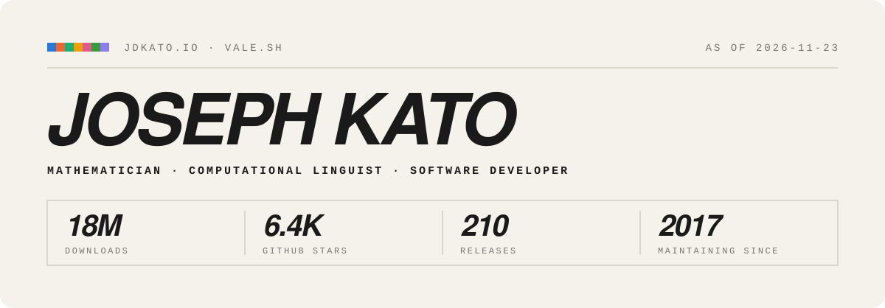

  <samp>
    <a href="https://jdkato.io">jdkato.io</a> ·
    <a href="https://jdkato.io/stories">stories</a> ·
    <a href="https://vale.sh">vale.sh</a> ·
    <a href="https://github.com/sponsors/jdkato">sponsor</a> ·
    <a href="mailto:joseph@jdkato.io">email</a>
  </samp>

I build software for writing. [Vale](https://github.com/vale-cli/vale), a linter that treats prose like code, is used by more than 390 companies and organizations. [prose](https://github.com/jdkato/prose), an NLP library for Go, is built into Hugo. I also write [data stories](https://jdkato.io/stories) about language, law, and sports.

<table><tr><td valign="top" width="55%">

#### Latest stories

<!-- essays:start -->

- [AI Tells: the words that left](https://jdkato.io/stories/arxiv-ai-tells) Nov 2026
- [Did the Plain Writing Act work?](https://jdkato.io/stories/plain-writing-act) Nov 2026
- [The hedge words of science](https://jdkato.io/stories/arxiv-hedging) Aug 2026
- [AI Tells: the burden of LLMs](https://jdkato.io/stories/github-ai-tells) Aug 2026
<!-- essays:end -->

</td><td valign="top" width="45%">

#### Releases

<!-- releases:start -->
- [prose](https://github.com/jdkato/prose) [v3.3.2](https://github.com/jdkato/prose/releases/tag/v3.3.2) Nov 20, 2026
- [vale](https://github.com/vale-cli/vale) [v3.28.1](https://github.com/vale-cli/vale/releases/tag/v3.28.1) Nov 19, 2026
- [vale-ls](https://github.com/vale-cli/vale-ls) [v0.6.0](https://github.com/vale-cli/vale-ls/releases/tag/v0.6.0) Oct 1, 2026
- [packages](https://github.com/vale-cli/packages) [v0.5.0](https://github.com/vale-cli/packages/releases/tag/v0.5.0) Sep 28, 2026
<!-- releases:end -->

#### Recognition

- [Write Better with Vale](https://pragprog.com/titles/bhvale/write-better-with-vale/), a Pragmatic Bookshelf book
- [Thoughtworks Technology Radar](https://www.thoughtworks.com/radar/tools/vale)
- [FLOSS/fund](https://floss.fund/blog/second-tranche-2025-anniversary/) grant 2025
- [Google Open Source Peer Bonus](https://opensource.googleblog.com/2023/05/google-open-source-peer-bonus-program-announces-first-group-of-winners-2023.html) 2023
- [Appwrite OSS Fund](https://dev.to/appwrite/appwrite-oss-fund-sponsors-vale-4oig) grant

</td></tr></table>
